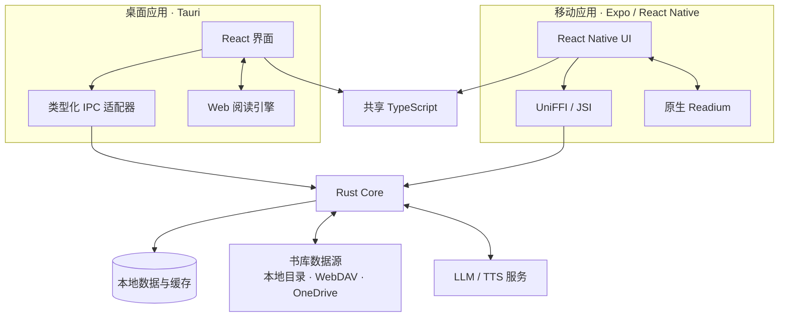
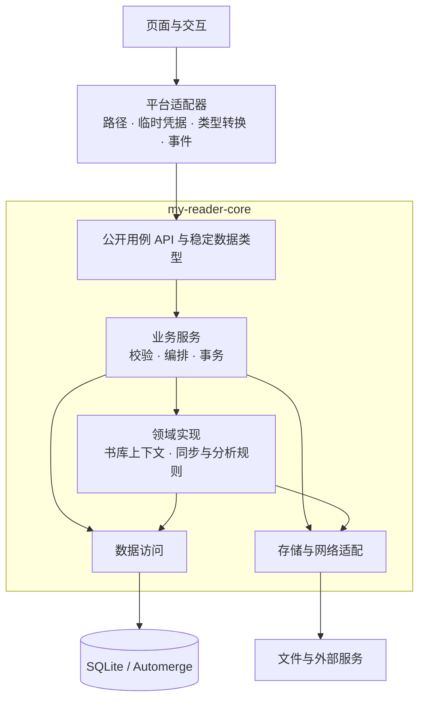
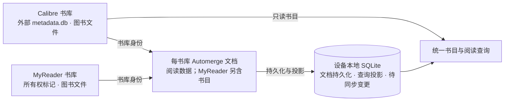
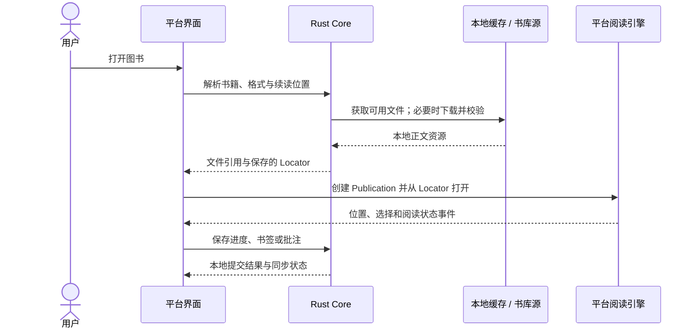
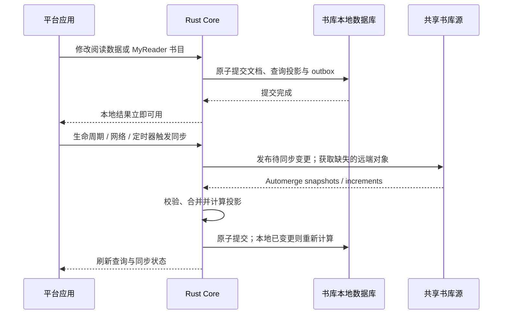
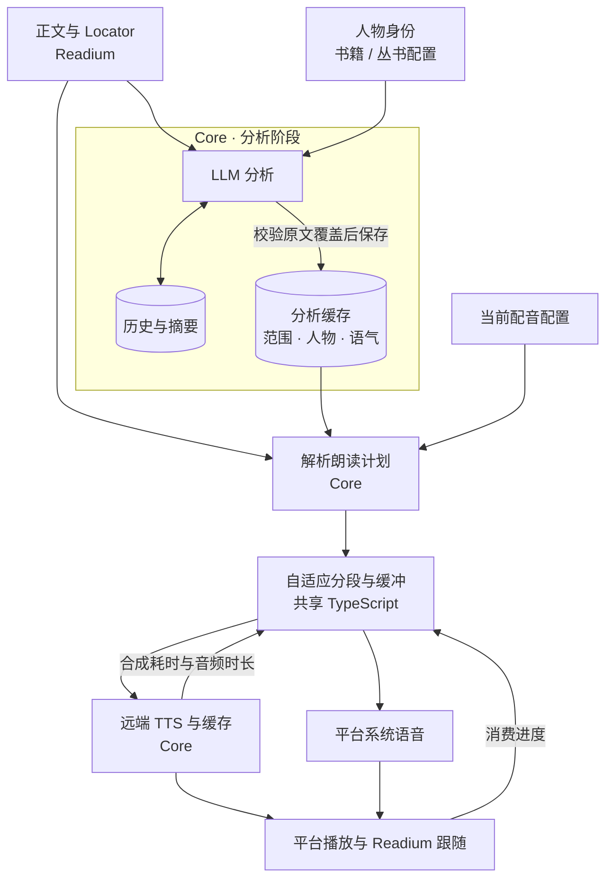

<a href="./ARCHITECTURE_EN.md">English</a>

# MyReader 架构

MyReader 是 Local-First 跨平台阅读器。桌面、iOS 和 Android 共享业务与数据内核，
各平台保留自己的界面、阅读渲染和系统集成。本文描述当前系统的组成、数据所有权和运行逻辑。
设计取舍见 [ADR](./adr/README.md)，构建与测试见 [开发指南](./DEVELOPMENT.md) 和
[质量指南](./QUALITY.md)。

## 1. 系统组成

Rust Core 是进程内共享后端，不依赖 MyReader 中心服务器。阅读已缓存的图书和保存阅读数据
可以离线完成；远程内容获取、同步和远端 AI 推理按需使用网络。

| 组件 | 职责 |
| --- | --- |
| `my-reader` | 桌面界面、Tauri 适配、Web 阅读引擎及窗口与系统集成 |
| `my-reader-mobile` | 移动界面、平台流程及原生模块集成 |
| `my-reader-core` | 跨端业务用例、持久化、书库访问、同步与 AI 服务编排 |
| 移动 Core binding | 在 TypeScript 与 Rust 之间转换类型并传递异步调用 |
| 移动 Readium bridge | 原生 Publication、Navigator、定位、搜索、标记与播放集成 |
| `packages/tools` | 跨端稳定类型、阅读会话语义和缓冲等纯算法 |
| `packages/i18n`、`packages/fonts` | 共享翻译资源与阅读字体资产 |

## 2. 依赖与职责边界

界面使用 Query 管理后端查询状态，Zustand 管理 UI 状态。
平台适配器准备调用条件并呈现结果；业务校验、数据库写入、合并和迁移由 Core 统一拥有。
依赖从界面流向业务和基础设施，底层不反向依赖界面或国际化组件。

界面与阅读渲染不跨端共享。系统目录授权、OAuth 交互、凭据存储、音频焦点、播放、窗口及
应用生命周期由平台实现。Core 只接收执行请求所需的临时凭据，持久配置保存凭据引用。
移动 Core binding 与 Readium bridge 是两个独立边界：前者承载业务，后者承载阅读器能力。

## 3. 数据所有权

书库的**所有权**决定能修改什么，**数据源**决定数据存在哪里；两者相互独立。

| 数据 | 权威与生命周期 |
| --- | --- |
| Calibre 书目 | 外部 `metadata.db`；MyReader 始终只读，远程副本下载后在本地查询 |
| MyReader 书目 | 每书库 Automerge 文档；SQLite 中的书目表是可重建的查询投影 |
| 阅读数据 | 同一书库文档中的进度、收藏、书签、批注、阅读会话和完成记录 |
| 设备设置与 AI 数据 | 本地书库注册、偏好、供应商配置，以及人物、分析历史和计划；不参与当前同步协议 |
| 凭据 | 平台安全存储；不进入书库文档、分析历史或可持久化的前端数据 |
| 派生缓存 | 正文、封面、同步对象和音频等本地缓存；可重新获取或生成，不替代数据权威 |

每个书库有独立的本地 SQLite sidecar；远程书库也在本设备维护活动数据库。
设备之间交换 Automerge 对象，不共享正在写入的 SQLite 文件。MyReader 书库不会生成 Calibre
的 `metadata.db`，复用查询表结构不代表两类书库可以互相转换。

Core 的有序数据库迁移是 MyReader schema 与升级历史的唯一来源；实体映射服务于查询。
外部 Calibre 数据库按实际读取能力验证，不进入 MyReader 的迁移链。

## 4. 打开与阅读图书

跨端使用 Publication、Link 和 Locator 描述书籍与内容位置。Locator 表示可恢复的原文位置，
不等同于随屏幕和排版变化的视觉页码。

| 格式 | 桌面阅读引擎 | 移动阅读引擎 |
| --- | --- | --- |
| EPUB | Web Readium | Readium Swift / Kotlin EPUB Navigator |
| PDF | PDF.js 与 Locator 适配 | Readium PDF Navigator |
| CBZ | Divina / fixed-layout 适配 | Readium fixed-layout / CBZ Navigator |

搜索、选择、标记和分享由对应引擎及平台能力实现，业务通过共同的位置语义协作。
导航历史属于打开的阅读会话，持久阅读进度负责下次续读。显式跳转创建历史，普通翻页与朗读
跟随只更新当前项；同步收到其他设备的位置时提供导航入口，不直接移动当前视口。

## 5. 本地提交、同步与内容传输

Core 维护每书库的因果关系、冲突收敛、待同步变更和同步调度策略；平台只提供触发事件与
实际计时。短暂网络故障退避重试，凭据、配置或完整性问题暂停等待修复。远程 I/O 和合并
计算在数据库写事务之外进行，本地提交不等待网络。

远端存储使用 Automerge 的 snapshot/incremental 对象模型，本地复用已校验对象以减少传输。
查询投影随文档提交一起更新，可由权威文档重建；阅读位置的并发候选在 Core 中统一处理。

正文传输与元数据同步使用同一数据源，但拥有独立的任务生命周期。正文必须就绪后才发布
对应书目，避免其他设备看到无法取得的图书；删除则先发布逻辑删除，再清理文件。
传输中间状态留在设备本地，不进入 Automerge 合并。

## 6. AI 分析与朗读

分析与语音生成通过朗读计划衔接。LLM 只标注原文范围、人物身份和语气，不绑定音色，也不
重新生成正文。Core 在播放前根据当前人物设置解析模型、音色和最终指令，因此修改配音可以
复用已有分析。未启用分角色朗读时，正文直接使用阅读器的朗读配置。

人物身份由用户维护，或由书中介绍、百科来源和用户提示辅助整理；同一书库的同一丛书共享
人物配置。章节正文按模型预算分批分析，按书籍与正文版本保存历史并压缩较早记录，回读时只
使用目标之前的上下文。摘要辅助分析，不取代权威人物列表。

| 状态 | 边界 |
| --- | --- |
| 人物与分析缓存 | Core 持久化；身份、正文或分析配置变化使相关结果失效，配音变化只重新解析计划 |
| 合成音频缓存 | Core 按文本、供应商、模型、音色和指令等生成参数隔离；只保存完成的音频 |
| 性能估计与待播缓冲 | 设备运行时状态；依据真实生成速度、音频时长和播放余量调整请求大小与预生成量 |

Readium 持有正文位置，平台持有实际播放器。一个原文定位单元可对应多个合成片段，只有
该单元最后一段播放完成才推进位置。停止、跳转或配置变化会取消过期工作；会话版本检查
阻止迟到的分析与播放结果重新生效。LLM 流式增量用于进度反馈，完成并通过校验后才成为结果。

生产路径采用 Core 内的有限任务编排与直接 API 调用，不引入额外 agent 运行时或 Node 服务。
该选择及人物分析约束见 [ADR-0024](./adr/0024-llm-book-narration-in-core.md)。

## 7. 关键设计索引

| 主题 | 设计依据 |
| --- | --- |
| 阅读引擎与平台边界 | [Readium 架构](./adr/0005-adopt-readium-reader-architecture.md)、[移动集成](./adr/0013-maintain-mobile-readium-integration.md) |
| 共享代码与后端 | [Monorepo 所有权](./adr/0007-pnpm-monorepo-and-shared-code-ownership.md)、[Rust Core](./adr/0019-adopt-modular-my-reader-core.md) |
| 数据权威与同步 | [Automerge 同步](./adr/0016-adopt-automerge-for-library-sidecar-sync.md)、[事件调度](./adr/0017-event-driven-library-sidecar-sync-scheduling.md)、[对象存储模型](./adr/0020-adopt-automerge-repo-storage-model.md) |
| 可写书库 | [MyReader 自有书库](./adr/0021-support-myreader-managed-libraries.md) |
| 阅读位置与导航 | [会话导航历史](./adr/0023-session-reading-navigation-history.md) |
| 朗读与 AI 分析 | [TTS 职责划分](./adr/0022-adopt-readium-tts-and-core-provider-architecture.md)、[人物朗读编排](./adr/0024-llm-book-narration-in-core.md) |
