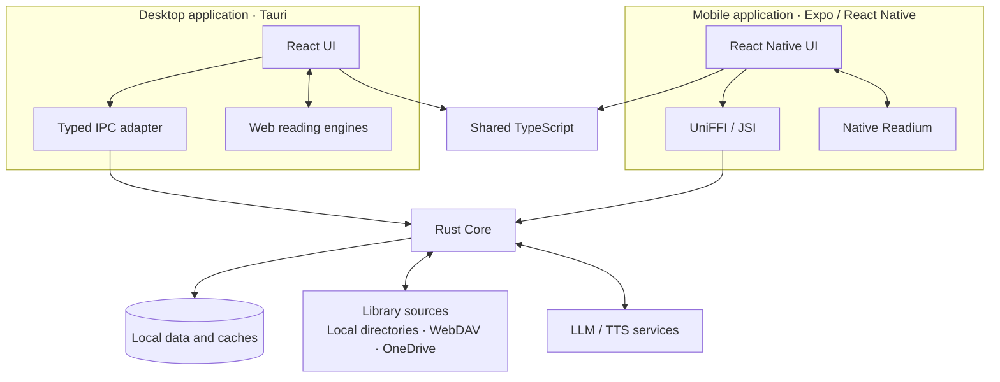
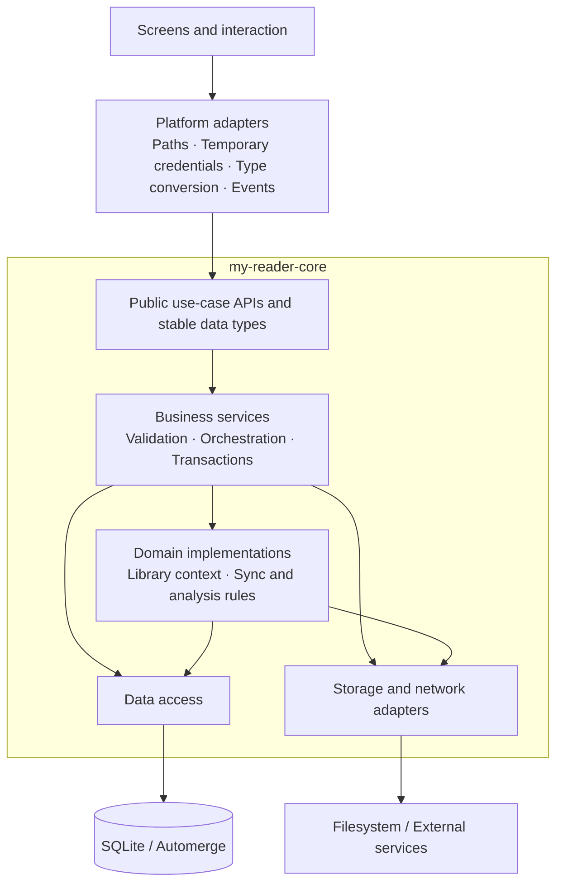
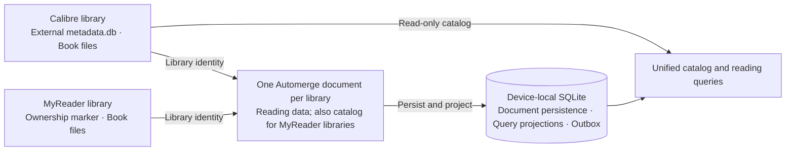
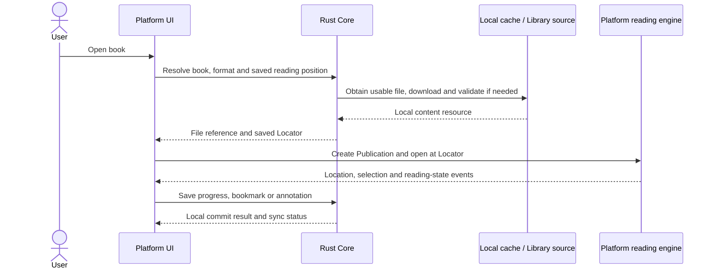
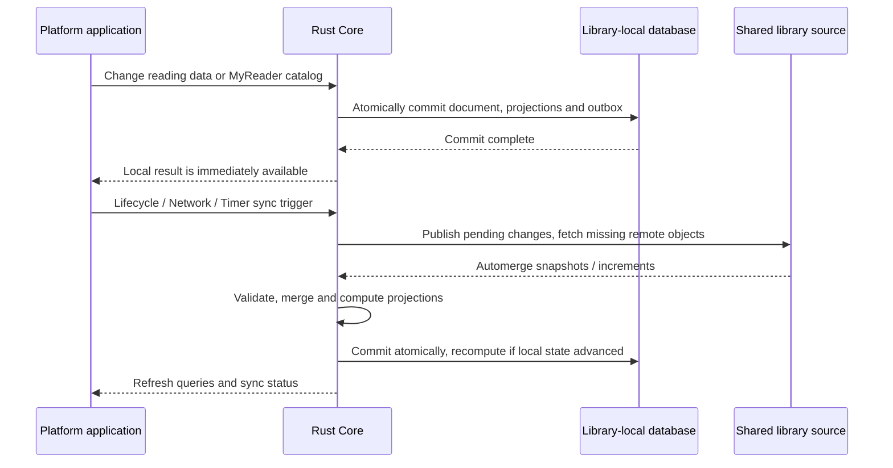
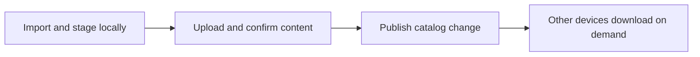
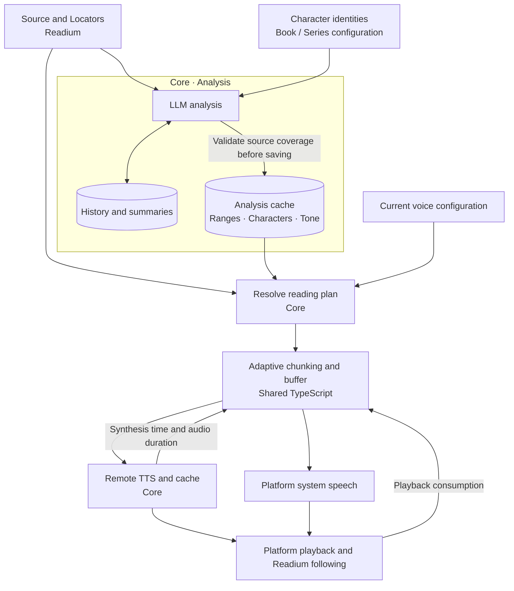

<a href="./ARCHITECTURE.md">简体中文</a>

# MyReader Architecture

MyReader is a local-first, cross-platform reader. Desktop, iOS and Android share the business and data
core while retaining their own interfaces, reading engines and system integrations. This document
covers the current components, data ownership and runtime flows. Design decisions belong in
[ADRs](./adr/README.md); build and test procedures are in [Development](./DEVELOPMENT_EN.md) and
[Quality](./QUALITY.md).

## 1. System Components

Rust Core is an in-process backend, with no central MyReader server. Reading cached books and saving
reading data work offline; remote content, synchronization and remote AI inference use the network
when needed.

| Component | Responsibility |
| --- | --- |
| `my-reader` | Desktop UI, Tauri adapter, web reading engines, windows and system integration |
| `my-reader-mobile` | Mobile UI, platform workflows and native module integration |
| `my-reader-core` | Shared use cases, persistence, library access, synchronization and AI orchestration |
| Mobile Core binding | Type conversion and asynchronous calls between TypeScript and Rust |
| Mobile Readium bridge | Native Publication, Navigator, location, search, decorations and playback integration |
| `packages/tools` | Stable cross-platform types, reader session semantics and pure algorithms such as buffering |
| `packages/i18n`, `packages/fonts` | Shared translations and reading font assets |

## 2. Dependencies and Ownership

The UI uses Query for backend query state and Zustand for UI state.
Platform adapters prepare calls and present results. Core owns business validation, database writes,
merging and migration. Dependencies flow from the interface toward business logic and infrastructure;
lower layers do not depend on UI or localization components.

UI and reading surfaces remain platform-specific. Directory access, OAuth interaction, secure storage,
audio focus, playback, windows and application lifecycle belong to the platform. Core receives only
the temporary credentials needed for a request and persists credential references. The mobile Core
binding and Readium bridge are separate boundaries for business operations and reader capabilities.

## 3. Data Ownership

Library **ownership** determines which operations are allowed; the **data source** determines where
the data lives. These are independent dimensions.

| Data | Authority and lifetime |
| --- | --- |
| Calibre catalog | External `metadata.db`, always read-only to MyReader; remote copies are downloaded for local queries |
| MyReader catalog | The library's Automerge document; SQLite catalog tables are rebuildable query projections |
| Reading data | Progress, favorites, bookmarks, annotations, reading sessions and completions in the same library document |
| Device settings and AI data | Local library registration, preferences, provider configuration, characters, analysis history and plans; outside the current sync protocol |
| Credentials | Platform secure storage; excluded from library documents, analysis history and persistable frontend data |
| Derived caches | Local content, covers, sync objects and audio that can be fetched or generated again; never a replacement for authoritative data |

Each library has an independent local SQLite sidecar. Remote libraries also keep their active database
on the device. Devices exchange Automerge objects instead of sharing a live SQLite file. MyReader
libraries do not generate Calibre's `metadata.db`; reusing query table shapes does not make the two
library types interchangeable.

Core's ordered database migrations are the single authority for MyReader's schema and upgrade history;
entity mappings support queries. External Calibre databases are validated against required reading
capabilities and never enter the MyReader migration chain.

## 4. Opening and Reading a Book

Publication, Link and Locator provide shared semantics for books and content positions. A Locator is
a recoverable source location, not a visual page number that changes with layout or screen size.

| Format | Desktop engine | Mobile engine |
| --- | --- | --- |
| EPUB | Web Readium | Readium Swift / Kotlin EPUB Navigator |
| PDF | PDF.js with Locator adaptation | Readium PDF Navigator |
| CBZ | Divina / fixed-layout adaptation | Readium fixed-layout / CBZ Navigator |

Search, selection, decorations and sharing depend on the engine and platform; common location
semantics connect them to the business layer. Navigation history belongs to the open reading session,
while persistent progress supports reopening. Explicit jumps create history; normal page turns and
speech following update the current entry. Positions received from another device become navigation
options without moving the current viewport.

## 5. Local Commits, Synchronization and Content Transfer

Core owns per-library causality, conflict convergence, pending changes and scheduling policy. The
platform supplies events and timers. Transient network failures back off and retry; credential,
configuration or integrity failures suspend until repaired. Network I/O and merge computation happen
outside database write transactions; local commits do not wait for the network.

Remote storage follows Automerge's snapshot/incremental object model. Devices reuse verified objects
to reduce transfer. Query projections update with the document commit and can be rebuilt from it;
Core also resolves concurrent reading-position candidates consistently across platforms.

Content transfer and metadata synchronization share a data source but have separate task lifecycles.
Content must be available before its catalog change is published, preventing other devices from seeing
unavailable books. Deletion publishes a logical tombstone before cleaning up files. Intermediate
transfer state remains device-local and does not participate in Automerge merging.

## 6. AI Analysis and Narration

Reading plans connect analysis to speech generation. The LLM labels source ranges, character identities
and tone without selecting voices or rewriting the text. Before playback, Core resolves the current
model, voice and final instructions from character settings, allowing voice changes to reuse existing
analysis. With character narration disabled, the source uses the reader's speech configuration directly.

Users maintain character identities, assisted by book introductions, encyclopedia sources or their own
prompts. Books in the same series within a library share a character configuration. Chapter text is
analyzed in batches within model budgets, with history scoped by book and content version. Analysis
summarizes older history and uses only preceding context when rereading. Summaries assist it without replacing the
authoritative character list.

| State | Boundary |
| --- | --- |
| Characters and analysis cache | Persisted by Core; identity, content or analysis configuration changes invalidate affected results, while voice changes only re-resolve plans |
| Synthesized audio cache | Isolated by text, provider, model, voice, instructions and other synthesis parameters; only completed audio is stored |
| Performance estimates and playback buffer | Device runtime state; measured generation speed, audio duration and playback reserve determine request size and prefetch volume |

Readium owns source positions; the platform owns actual playback. One source unit may produce several
audio chunks, and the position advances only when its final chunk finishes. Stop, navigation and
configuration changes cancel obsolete work. Session-version checks prevent late analysis or playback
results from becoming active again. LLM deltas provide progress feedback; only a complete, validated
response becomes a result.

Production uses bounded workflows and direct API calls within Core, without an additional agent
runtime or Node service. See [ADR-0024](./adr/0024-llm-book-narration-in-core.md) for this decision and
the character-analysis constraints.

## 7. Key Design Decisions

| Topic | Design references |
| --- | --- |
| Reading engines and platform boundaries | [Readium architecture](./adr/0005-adopt-readium-reader-architecture.md), [mobile integration](./adr/0013-maintain-mobile-readium-integration.md) |
| Shared code and backend | [Monorepo ownership](./adr/0007-pnpm-monorepo-and-shared-code-ownership.md), [Rust Core](./adr/0019-adopt-modular-my-reader-core.md) |
| Data authority and synchronization | [Automerge sync](./adr/0016-adopt-automerge-for-library-sidecar-sync.md), [event scheduling](./adr/0017-event-driven-library-sidecar-sync-scheduling.md), [object storage](./adr/0020-adopt-automerge-repo-storage-model.md) |
| Writable libraries | [MyReader-managed libraries](./adr/0021-support-myreader-managed-libraries.md) |
| Reading positions and navigation | [Session navigation history](./adr/0023-session-reading-navigation-history.md) |
| Narration and AI analysis | [TTS ownership](./adr/0022-adopt-readium-tts-and-core-provider-architecture.md), [character narration orchestration](./adr/0024-llm-book-narration-in-core.md) |
