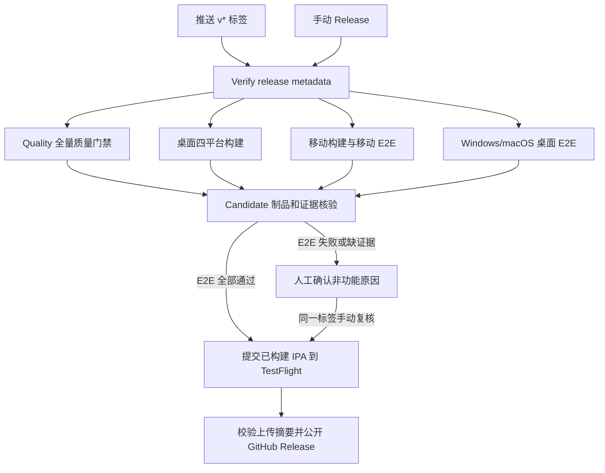

# MyReader 标签发布流程迁移前审计

以下是 0.23.0 的历史快照。后续版本按[发布手册](./RELEASE.md)操作。

> 审计日期：2026-11-20
> 审计对象：`main`、版本标签 `v0.23.0`、GitHub Actions Release run `44611030626` attempt 4
> 本文只记录当前行为和已经观察到的问题，不包含工作流改造方案。

`v0.23.1` 起按[发布手册](./RELEASE.md)执行，发布候选不再构建或上传 Linux 产物。本文中关于 Linux 产物的内容属于 `v0.23.0` 标签流程的历史记录。

## 当前版本状态

- 审计开始时工作区干净，`main` 与 `origin/main` 一致。本次整理只新增本文件和一个文档链接。
- `main`、远端 `v0.23.0` 标签和提交 `d3ebd9d260e8d425eab9c692c23a7f2cc4bf731f` 一致。
- `v0.23.0` 的桌面版本和移动版本都是 `0.23.0`。
- GitHub Release `v0.23.0` 尚未创建，公开的最新 Release 仍是 `v0.22.0`。
- `v0.23.0` 的最近一次 Release run 失败，因此没有进入候选包、TestFlight 提交或公开 Release 阶段。

## 触发入口

### 版本标签

向仓库推送匹配 `v*` 的标签会触发 `.github/workflows/release.yml`。`verify` 会读取
`my-reader/src-tauri/tauri.conf.json` 和 `my-reader-mobile/app.json`，要求桌面和移动版本一致，
并在标签事件中要求标签版本与这两个版本一致。

### 手动运行

手动运行同一个 `Release` 工作流有两种行为。

| 输入 | 当前行为 | 是否构建和测试 | 是否提交 TestFlight | 是否公开 GitHub Release |
| --- | --- | --- | --- | --- |
| `review_run_id` 为空 | 完整演练 | 是 | 否 | 否 |
| `review_run_id` 为原始标签 Release run ID | 复用候选包进行复核放行 | 否，跳过原始构建和测试 | 是 | 是 |

复核运行还必须填写 `non_functional_e2e_reason`。复核入口要求原始运行是同一标签触发的、
已经完成的 `Release` run，并且提交号、候选包和每个文件的摘要都一致。

## 总体流程

`quality`、桌面构建、移动构建和桌面 E2E 在 `verify` 成功后并行启动。移动构建内部还会把
Android APK、iOS IPA、iOS simulator 包分开构建。Android APK 和 iOS simulator 包生成后，
分别启动对应的 Maestro 测试。桌面 E2E 在各自 runner 上重新构建带测试 transport 的 Release
应用，再运行浏览器和原生套件。

## 工作流和工作职责

| 阶段 | 工作流或脚本 | 当前职责 | 结果性质 |
| --- | --- | --- | --- |
| 版本校验 | `release.yml` / `verify` | 校验桌面、移动版本和标签 | 硬门禁 |
| 质量门禁 | `quality.yml` | 静态检查、单元测试、覆盖率、Rust、Swift、Android、安全和聚合门禁 | 硬门禁 |
| 桌面构建 | `desktop-build.yml` | macOS Apple Silicon、macOS Intel、Windows x64、Linux x64 安装包 | 硬门禁 |
| 移动构建 | `mobile-build.yml` | 签名 Android APK、生产 iOS IPA、iOS Release simulator app | 硬门禁 |
| 移动 E2E | `mobile-e2e.yml` | Android、iPhone、iPad 的 Release Maestro 套件 | 当前为 advisory，结果仍写入候选证据 |
| 桌面 E2E | `desktop-e2e.yml` | Windows 和 macOS Intel 的浏览器集成、前端 E2E、原生 WebDriver 套件 | 当前为 advisory，结果仍写入候选证据 |
| 候选核验 | `scripts/release/candidate.mjs` | 核验八个公开安装包、APK 摘要、E2E 报告和被测包摘要，生成 `release-evidence.json` | 候选包门禁 |
| 人工复核 | `scripts/release/review.mjs` | 绑定原始 run、标签、提交、候选文件和复核原因 | 只允许确认非功能 E2E 问题 |
| TestFlight | `release.yml` / `submit-ios` | 下载原始构建出的 IPA，按 production profile 提交内部 TestFlight | 发布前硬门禁 |
| GitHub Release | `release.yml` / `publish`、`verify-upload.mjs` | 从 `CHANGELOG.md` 取版本说明，创建或更新草稿，上传并校验所有文件摘要，最后公开 | 最终发布动作 |

## 产物清单

候选包要求八个公开安装包，`candidate.mjs` 会按扩展名和数量检查它们。

| 平台 | 产物 | Actions artifact | 最终去向 |
| --- | --- | --- | --- |
| macOS Apple Silicon | 一个 DMG | `MyReader-macOS-arm64` | GitHub Release |
| macOS Intel | 一个 DMG | `MyReader-macOS-x64` | GitHub Release |
| Windows x64 | 一个 MSI、一个 NSIS 安装程序 | `MyReader-Windows-x64` | GitHub Release |
| Linux x64 | 一个 AppImage、一个 DEB、一个 RPM | `MyReader-Linux-x64` | GitHub Release |
| Android | 一个签名 APK 和 `.sha256` 文件 | `MyReader-Android-APK` | GitHub Release |
| iOS | 一个 production IPA | `MyReader-iOS-IPA` | 只提交 TestFlight |
| iOS simulator | 一个 Release `.app` 压缩包 | `MyReader-iOS-simulator` | 只用于 iPhone/iPad E2E 证据 |

macOS 生产构建会导入 Developer ID 证书，并对 DMG 执行 notarization、staple、validate 和
`spctl` 检查。Windows 仍由 GitHub Actions 构建。当前工作流没有把个人 Mac 注册为生产
self-hosted runner。

## 质量门禁组成

`quality.yml` 先通过 `changed-areas` 判断需要运行的语言和检查范围。PR 会按变更范围选择任务，
发布标签和手动运行则按工作流约定执行全量检查。

### JavaScript 和静态检查

- `static` 执行 actionlint、格式检查、文档检查、生成文件检查、架构检查、未使用代码检查和重复代码检查。
- `unit` 矩阵覆盖 `@my-reader/fonts`、`@my-reader/i18n`、`@my-reader/tools`、`my-reader` 和 `my-reader-mobile`。
- `coverage` 矩阵生成五个 JavaScript/TypeScript 覆盖率报告。
- `mutation` 对配置范围内的共享 TypeScript 模块运行变异测试。

### 原生和安全检查

- `rust` 在 Ubuntu 和 Windows 上执行格式、Clippy 和 workspace 测试。
- `rust-coverage` 生成 Core/FFI 覆盖率。
- `rust-desktop-coverage` 在 macOS 和 Windows 采集桌面 Rust 覆盖率。
- `android-coverage` 执行 Readium、Google Authorization、Expo Sharing 的 JVM 和设备覆盖率。
- `swift-coverage` 在 Apple Silicon macOS runner 上执行完整原生测试 scheme，并导出 Swift 覆盖率。
- `ios-dependencies` 每次在无缓存依赖条件下检查 iOS Readium 依赖。
- `security` 执行 pnpm production dependency audit 和 Cargo audit。

### 聚合门禁

- `QA` 汇总静态、iOS 依赖、变异、Rust 和安全任务。
- `Unit tests` 汇总 JavaScript、Rust、Android、Swift 和覆盖率任务。
- 标签和手动运行使用 `Coverage report integrity`，PR 使用 `Changed-line coverage`。
- 公开发布前，质量聚合、构建结果和候选包完整性都必须通过。E2E 的失败、缺报告、跳过或
  flaky 结果不会自动被当作通过，而是进入候选复核路径。

## 候选包、复核和发布校验

### Candidate

候选阶段会从 Actions 下载桌面、Android 和 E2E artifacts，并执行以下校验。

- 安装包文件名唯一，DMG/MSI/EXE/AppImage/DEB/RPM/APK 数量符合预期。
- APK 的 `.sha256` 文件与实际文件摘要一致。
- E2E 报告属于当前提交，且套件清单与仓库中的 `release-suite.json`、桌面 `suite.json` 一致。
- Android 被测 APK 的摘要与要发布的 APK 一致。
- iPhone 和 iPad 使用同一个 simulator app 摘要。
- 浏览器集成报告和前端 E2E 报告没有 unexpected、skipped、flaky 或 runner error。
- 所有文件被压平到候选根目录，并生成 `release-evidence.json`。

Candidate 会把所有 E2E 结果写入证据。E2E 全部通过时输出 `publishable=true`。只要有失败或
缺少报告，就输出 `review-required`，保留候选包和报告。

### Review

人工复核不重建、不重跑 E2E，也不重新生成 IPA。它下载原始 run 的
`MyReader-Release-Candidate`，校验以下身份关系。

- 原始 run 来自 `.github/workflows/release.yml` 的标签 push。
- 原始 run 已完成，标签、提交号、仓库和 run attempt 与候选证据一致。
- 候选包仍然包含八个公开安装包，所有 SHA-256 仍然匹配。
- 复核人和非功能原因已填写。

通过后，脚本把复核人、原因、原始 run URL 和时间写入 `release-evidence.json`，同时保留原始
失败结果。

### Submit 和 Publish

`submit-ios` 下载原始 run 中已经通过候选校验的 IPA，并使用 EAS production profile、内部
TestFlight group 和 `--wait` 提交。提交成功后，`publish` 才会继续。

`publish` 会从 `CHANGELOG.md` 取当前版本标题下的内容，检查候选证据中的提交号和所有文件
SHA-256，然后创建或更新 GitHub draft Release。所有文件上传完成后，读取 GitHub 返回的资产
状态、大小和 `sha256:` 摘要，执行 `verify-upload.mjs`。校验成功后才将 draft 改成公开并标记
为 latest。

## Runner 分布

| Runner | 当前用途 |
| --- | --- |
| `ubuntu-22.04` | 版本校验、Candidate、Review、Publish、Linux 构建、Android APK/E2E、JavaScript 质量任务及多数 Rust/安全任务 |
| `windows-latest` | Windows x64 桌面安装包和桌面 E2E |
| `windows-2022` | Quality Rust 和桌面 Rust 覆盖率 |
| `macos-latest` | macOS Apple Silicon 桌面安装包，以及 Quality 的 macOS Rust 桌面覆盖率矩阵项 |
| `macos-26` | Quality Swift 原生覆盖率 |
| `macos-26-intel` | macOS Intel 桌面安装包、桌面 macOS E2E、iOS IPA、iOS simulator app、iPhone/iPad Maestro、TestFlight 提交和 iOS 依赖检查 |

当前 Mac 构建分散在 `macos-latest`、`macos-26` 和 `macos-26-intel` 三类 runner 上，
同一发布过程会多次创建短生命周期 macOS 虚拟机。Windows 构建和 Windows E2E 保留在 GitHub
Actions 的 Windows runner 上。

## 最近一次发布运行

运行链接：[Release run 44611030626 attempt 4](https://github.com/RyouMon/MyReader/actions/runs/44611030626/attempts/4)。

该运行由 `v0.23.0` 标签触发，运行时间为 2026-11-20 01:53:38 至 04:17:58 UTC，
总时长约 2 小时 24 分钟，最终失败。

| Job | 运行时长 | 结果 | 当前观察 |
| --- | ---: | --- | --- |
| macOS Apple Silicon 桌面构建 | 12 分 33 秒 | 成功 | 产物构建完成 |
| Windows x64 桌面构建 | 13 分 51 秒 | 成功 | 产物构建完成 |
| Linux x64 桌面构建 | 7 分 53 秒 | 成功 | 产物构建完成 |
| macOS Intel 桌面构建 | 41 分 58 秒 | 成功 | 产物构建完成 |
| Windows 桌面 E2E | 34 分 37 秒 | 成功 | 完整套件通过 |
| macOS Intel 桌面 E2E | 60 分 54 秒 | 失败 | 285 个通过，1 个 WebKit TTS 跨页场景在 5 秒断言等待中超时 |
| Android APK | 39 分 59 秒 | 成功 | 签名 APK 构建完成 |
| Android Maestro | 31 分 48 秒 | 成功 | 使用同一个 APK |
| iOS IPA | 1 小时 26 分 45 秒 | 成功 | IPA 构建完成 |
| iOS simulator app | 1 小时 54 分 48 秒 | 成功 | iPhone/iPad E2E 输入包构建完成 |
| Swift native coverage | 30 分 11 秒 | 失败 | `ReaderStartLocationTests.restoresSyncedTextAnchorInFreshNavigator(delayedFirstFrame:layout:)` 失败 |
| iPhone Maestro | 18 分 40 秒 | 失败 | `home-screen` 可见性断言失败 |
| iPad Maestro | 29 分 07 秒 | 失败 | `TTS verification` 可见性断言失败 |

Swift coverage 失败后，`Coverage report`、`Unit tests` 和 `Coverage report integrity` 是其
后的聚合失败。由于质量和 E2E 结果没有形成可发布候选，`candidate`、`submit-ios` 和
`publish` 都被跳过。以上 iOS 和桌面 E2E 失败尚未经过本次发布的人工非功能原因复核，不能
直接写成已接受的 flaky。

## 当前已确认的流程缺口

以下是从当前代码和最近运行中直接确认的事项，暂不表示已经决定如何修复。

1. `scripts/release/candidate.mjs` 当前查找 `e2e-desktop-macos-latest`，而
   `.github/workflows/desktop-e2e.yml` 上传的名称是 `e2e-desktop-macos-26-intel`。当前主分支
   存在名称不一致。由于最近一次运行在质量门禁阶段已失败，Candidate 尚未走到能够暴露该问题
   的位置。
2. 发布构建使用 `dtolnay/rust-toolchain@stable`，Quality 使用固定的 Rust `1.95.0`，工具链
   选择存在漂移。
3. Release 和 Quality 使用的 Node.js 补丁版本分别是 `22.22.0` 和 `22.22.2`，EAS profile
   还声明了 pnpm `11.28.5`。
4. EAS action 使用 `eas-version: latest`，发布时 EAS CLI 版本没有锁定到仓库文件中的具体版本。
5. iOS IPA、iOS simulator app、iPhone/iPad E2E、Swift coverage、iOS dependency check 和
   macOS Intel 桌面任务分布在不同短生命周期 macOS runner 上，每个任务都可能重复准备 Node、
   CocoaPods、Rust、Xcode 或模拟器环境。
6. macOS Intel 桌面 E2E 会重新构建带测试 transport 的 Release 应用，与桌面发布安装包构建
   有一段重复的 Rust 和前端准备过程。
7. iOS simulator 构建会生成 Core bindings、执行 Expo prebuild、执行 `pod install`，再做
   Xcode Release 构建。IPA 构建也独立执行 EAS local build 和原生依赖准备。
8. 最近一次失败同时包含质量测试时序问题、WebKit TTS E2E 超时和 iOS Maestro 断言失败，
   当前发布状态无法只靠重试次数区分产品失败、测试工具失败和 runner 环境失败。

## 本机 Mac 的已知能力边界

此前在 Apple Silicon Mac 上记录过以下本机基线。它们是本机命令的单次实测，不等同于完整 CI
发布耗时，也没有覆盖生产签名、notarization、IPA 分发签名或 TestFlight 提交。

| 本机任务 | 已记录耗时 | 结果 |
| --- | ---: | --- |
| Swift 原生测试 | 约 2 分 54 秒 | 78 项通过 |
| iOS simulator Release 编译 | 约 3 分 03 秒 | 完成 |
| Desktop Apple Silicon 完整构建 | 约 5 分 48 秒 | 完成 |
| Rust bindings | 约 3 分 14 秒 | 完成 |

审计当时尚未验证本机的 Developer ID 和 EAS 托管凭据，已验证的范围
主要是预构建、单元测试、Swift 测试、iOS simulator、Rust bindings 和 Apple Silicon 桌面
构建。生产 IPA、TestFlight、签名和 notarization 的现行入口仍在受控流水线中。Windows 产物
和 Windows E2E 当前继续使用 GitHub Actions。

## 优化前需要先保持的事实边界

- `v0.23.0` 尚未公开，标签、主分支和公开 Release 的状态目前不同步。
- 当前候选包只在质量和构建硬门禁通过后才会生成，E2E 失败时依赖人工复核入口复用同一批产物。
- iOS IPA、iOS simulator app 和 TestFlight 提交是不同阶段，模拟器通过不等于设备签名或 App Store 处理通过。
- Release E2E 使用完整 Release 包和真实系统/原生层，不能用 JavaScript 单元测试结果替代。
- 生产发布需要可追溯到同一标签、提交、run、候选文件摘要和 GitHub 上传摘要。

## 相关入口

- [Release 总工作流](../.github/workflows/release.yml)
- [桌面构建](../.github/workflows/desktop-build.yml)
- [移动构建](../.github/workflows/mobile-build.yml)
- [桌面 E2E](../.github/workflows/desktop-e2e.yml)
- [移动 E2E](../.github/workflows/mobile-e2e.yml)
- [质量门禁](../.github/workflows/quality.yml)
- [Candidate 校验](https://github.com/RyouMon/MyReader/blob/d3ebd9d260e8d425eab9c692c23a7f2cc4bf731f/scripts/release/candidate.mjs)
- [Review 校验](https://github.com/RyouMon/MyReader/blob/d3ebd9d260e8d425eab9c692c23a7f2cc4bf731f/scripts/release/review.mjs)
- [上传校验](../scripts/release/verify-upload.mjs)
- [发布 E2E runbook](../my-reader-mobile/e2e/README.md#发布流水线)
- [质量说明](./QUALITY.md)
